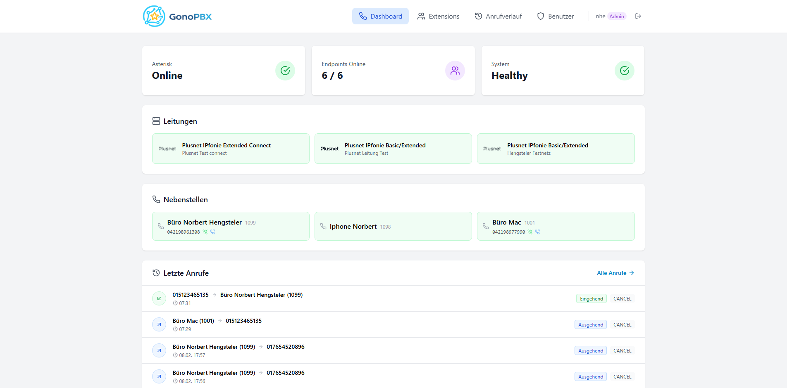
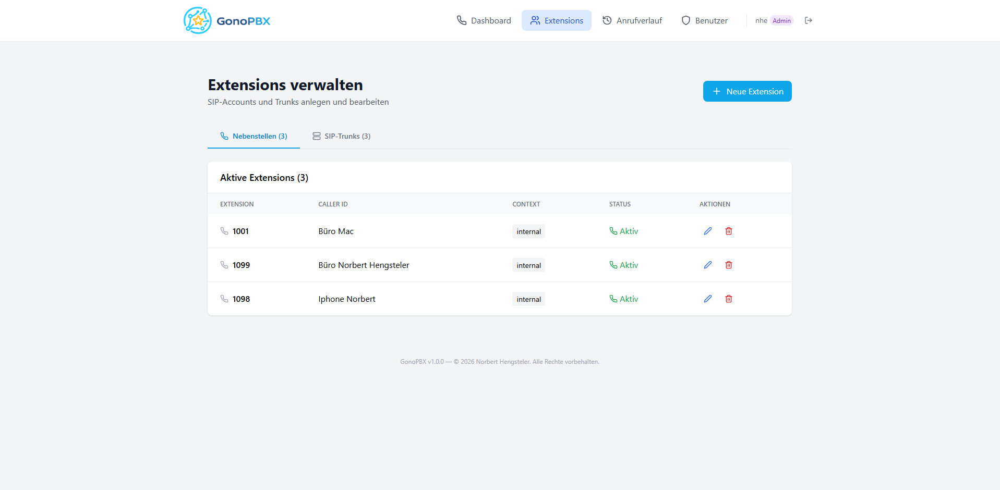
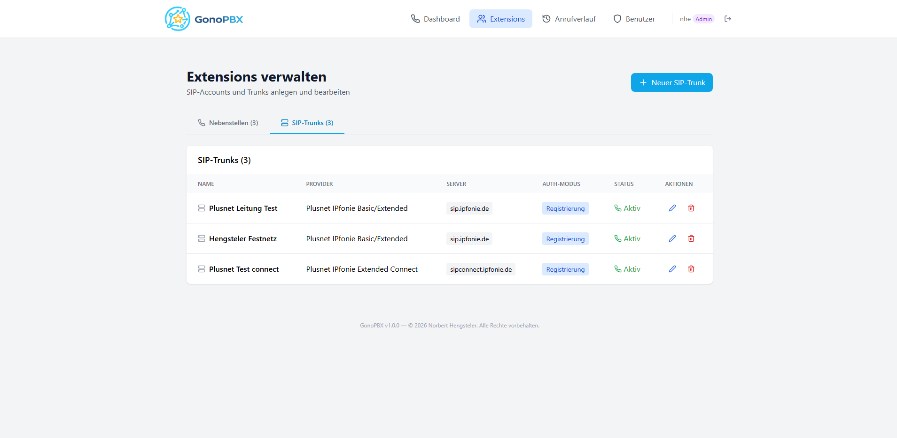
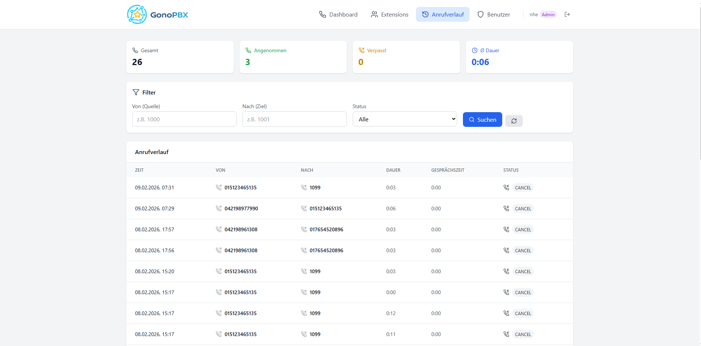
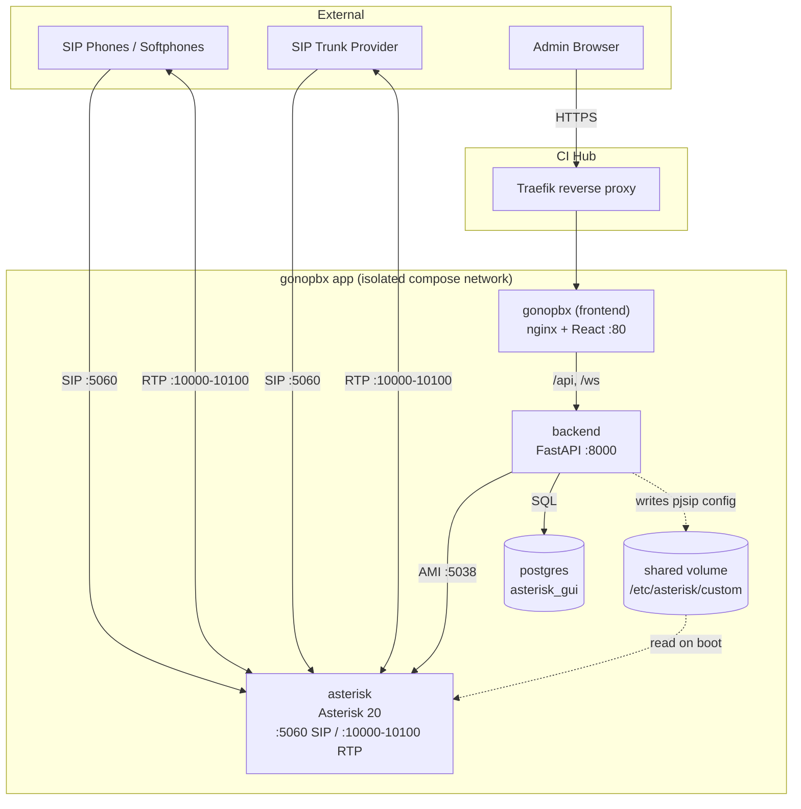
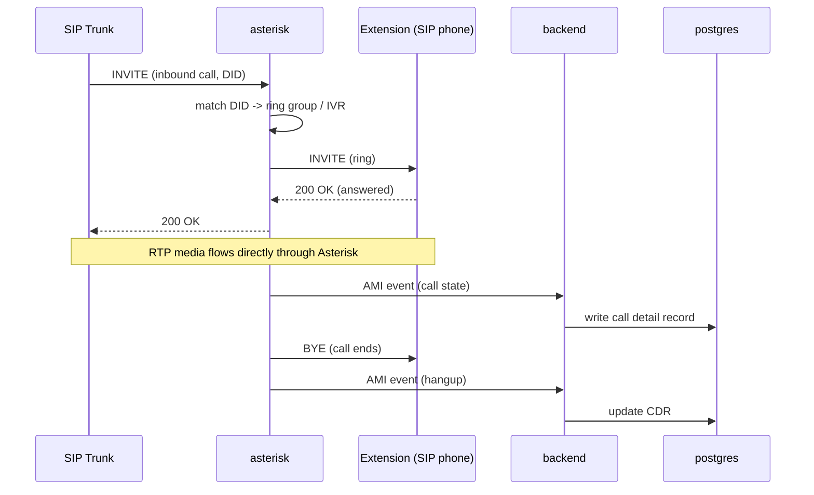

  

<h1 align="center">CI-GonoPBX</h1>

Build pipeline that publishes container images for <a href="https://github.com/ankaios76/gonopbx">GonoPBX</a> — an open-source Asterisk PBX web GUI — to <code>ghcr.io/companionintelligence</code> so it can be listed in <a href="https://github.com/companionintelligence/CI-Marketplace">CI-Marketplace</a> (see <a href="https://github.com/companionintelligence/CI-Marketplace/issues/700">issue #700</a>, <a href="https://github.com/companionintelligence/CI-Marketplace/pull/703">PR #703</a>).

## Why this repo exists

GonoPBX has no official pre-built images upstream — it's designed to be deployed by `docker compose build`-ing its `asterisk/`, `backend/`, and `frontend/` directories from source. Every app in the CI-Marketplace catalog references a pre-built, tagged image, so this repo exists solely to check out a pinned upstream ref and build+push those three images. **It does not vendor or modify GonoPBX's source** — the workflow checks out `ankaios76/gonopbx` directly at build time.

## What gets published

| Image | Upstream source dir | Notes |
|---|---|---|
| `ghcr.io/companionintelligence/gonopbx-frontend` | `frontend/` | React UI + nginx; nginx proxies `/api` and `/ws` to a service literally named `backend`, so the CI-Marketplace compose must keep that service name |
| `ghcr.io/companionintelligence/gonopbx-backend` | `backend/` | FastAPI backend |
| `ghcr.io/companionintelligence/gonopbx-asterisk` | `asterisk/` | Asterisk 20 (`andrius/asterisk:20` base) with GonoPBX's sound/config overlay |

Images are tagged to match the upstream git tag being built (e.g. `v2.1.1`), matching the `version` pinned in [`CI-Marketplace/apps/gonopbx/config.json`](https://github.com/companionintelligence/CI-Marketplace/blob/dev/apps/gonopbx/config.json).

## ⚠️ Licensing — needs a look before publishing

Upstream's README states the project is "open source and available under the [MIT License](LICENSE)," but **no `LICENSE` file actually exists in the upstream repo** (confirmed via GitHub's repo API and a direct 404 on `/LICENSE`). The stated intent is clearly MIT, but there's no committed license text to point to. Before treating these published images as freely redistributable, either:

- Open an issue/PR upstream ([ankaios76/gonopbx](https://github.com/ankaios76/gonopbx)) asking them to commit the missing `LICENSE` file, or
- Get explicit confirmation from the maintainer some other way,

and link the resolution here.

## Screenshots

Pulled from upstream's own [`website/screenshots`](https://github.com/ankaios76/gonopbx/tree/main/website/screenshots) (linked directly from [issue #700](https://github.com/companionintelligence/CI-Marketplace/issues/700)); mirrored here and in the CI-Marketplace store listing gallery.

| Dashboard | Extensions |
|---|---|
|  |  |

| SIP trunks | Call history |
|---|---|
|  |  |

## Architecture

Four containers per install, isolated on their own compose network. Only the frontend goes through Hub's Traefik proxy — Asterisk needs direct UDP/TCP access for SIP and RTP, which can't go through an HTTP reverse proxy.

Call signaling and CDR logging for a typical inbound call:

## Triggering a build

`.github/workflows/build-images.yml` is manually triggered (`workflow_dispatch`) with a `gonopbx_ref` input (the upstream git tag/ref to build, e.g. `v2.1.1`). It builds all three images and pushes them tagged with that ref.

**Known gap:** the `asterisk` image's base (`andrius/asterisk:20`) isn't confirmed to support `arm64`. The workflow attempts multi-arch (`amd64`,`arm64`) for all three images — if the asterisk build fails on `arm64`, drop it from that job's platform list and update `supported_architectures` in the CI-Marketplace manifest accordingly.

## After a successful build

1. Confirm all three images pulled successfully on both architectures you intend to support.
2. Flip `available: true` in `CI-Marketplace/apps/gonopbx/config.json`.
3. Run `scripts/verify-app.sh --slug gonopbx` against a real Hub instance from the CI-Marketplace repo.

## Icon

The store icon (`docs/assets/icon.png`, source `docs/assets/icon.svg`) is an original vector redraw of GonoPBX's own mark — the broken ring of connected nodes represents extensions/endpoints meshed through the PBX hub, and the center star nods to Asterisk (the engine underneath, and literally "a little star"). The original upstream logo is a wide wordmark lockup (`docs/assets/wordmark.png`) that doesn't crop cleanly to the square tile CI-Marketplace store listings need, so this repo maintains a proper square icon derived from the same visual language instead.
